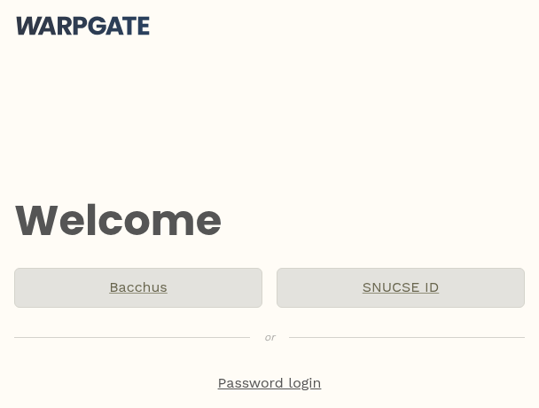
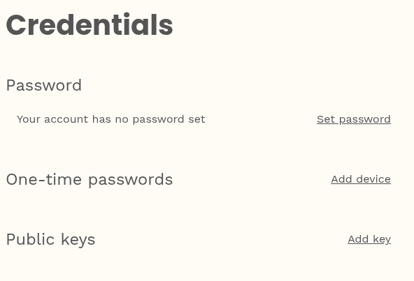
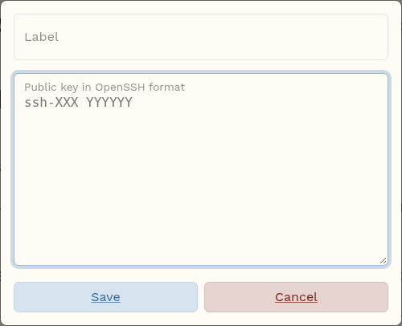

# 인스턴스에 접속하기

인스턴스는 외부에서 직접 닿을 수 없는 내부 주소를 받습니다. SSH는 접속 게이트웨이(cloud.snucse.org의 2222번 포트)를 거치고, 화면은 웹 UI의 콘솔로 봅니다.

## SSH

```console
$ ssh -p 2222 <내 유저명>:<SSH 이름>@cloud.snucse.org
```

이 명령은 내 유저명과 SSH 이름이 채워진 채로 인스턴스 화면의 **SSH 접속**에 있고, 인스턴스를 만든 직후 뜨는 **인스턴스 접속 정보** 창에도 나옵니다. 복사해서 쓰면 됩니다.

SSH 이름은 인스턴스 이름 앞에 계정 접두어가 붙은 꼴입니다(SNUCSE ID 계정은 `snucse-<유저명>-<인스턴스 이름>`). 접두어는 자동으로 붙습니다([SSH 이름](instance.md#ssh-이름)). 인스턴스 이름을 바꾸면 SSH 이름도 바뀌고([이름 바꾸기](instance.md#이름-바꾸기)), 예전 방식으로 만든 인스턴스는 옛 이름을 SSH 이름으로 그대로 씁니다.

처음 접속하면 터미널에 로그인 링크가 나옵니다. 그 링크를 브라우저로 열고 **SNUCSE ID**를 눌러 로그인하면 접속이 이어집니다.



**SSH 키를 만들어 등록할 필요가 없습니다.** 접속 게이트웨이가 SNUCSE ID로 본인을 확인하고 인스턴스에 대신 들어가므로, 어느 컴퓨터에서든 브라우저 로그인만으로 접속할 수 있습니다. 인스턴스 안에서는 템플릿의 기본 사용자(`ubuntu`, `debian` 등, 인스턴스 화면의 **로그인 계정**)로 들어가며, 접속 게이트웨이에서 오는 SSH는 인스턴스에 자동으로 허용되어 있습니다. 이 계정은 비밀번호 없이 `sudo`(Alpine은 `doas`)를 쓸 수 있고, root로는 직접 로그인하지 않습니다. 매번 브라우저 승인을 거치는 것이 번거로우면 [SSH 공개키를 등록](#브라우저-승인-없이-접속하기)해 두면 됩니다.

`~/.ssh/config`에 적어 두면 `scp`, `sftp`, VS Code Remote-SSH 등도 그대로 쓸 수 있습니다.

```
Host my-vm
    HostName cloud.snucse.org
    Port 2222
    User <내 유저명>:<SSH 이름>
```

```console
$ ssh my-vm
$ scp data.tar.gz my-vm:
```

본인 계정의 인스턴스에 접속할 수 있습니다. 다른 사람의 인스턴스에는 그 소유자가 아래 방법으로 열어 준 계정으로만 들어갑니다.

### 브라우저 승인 없이 접속하기

접속 게이트웨이는 브라우저 승인(SNUCSE ID) 대신 **등록된 SSH 공개키**로도 본인을 확인합니다. 자주 쓰는 컴퓨터의 키를 한 번 등록해 두면 그 컴퓨터에서는 승인 링크가 뜨지 않고 바로 접속됩니다.

1. 키가 없으면 만듭니다.

   ```console
   $ ssh-keygen -t ed25519
   ```

2. <https://login.cloud.snucse.org/@warpgate#/profile/credentials>를 열고 **SNUCSE ID**를 눌러 로그인합니다(로그인 뒤 오른쪽 위의 유저명 → **Credentials**로도 갑니다). **Public keys**의 **Add key**를 누릅니다.

   

   같은 페이지의 Password는 정해도 쓰이지 않습니다. 접속 게이트웨이의 로그인은 SNUCSE ID로만 합니다.

   Label에 이름(예: 노트북)을, 아래 칸에 `~/.ssh/id_ed25519.pub`의 내용(`ssh-ed25519 AAAA… 이름`)을 붙여 넣고 **Save**를 누릅니다.

   

3. 이제 그 키로 접속하면 승인 없이 들어갑니다. 키가 기본 경로에 없으면 `ssh -i <키 파일>` 또는 `~/.ssh/config`의 `IdentityFile`로 지정하세요.

등록된 키가 없는 컴퓨터에서는 종전처럼 브라우저 승인으로 접속됩니다. 키를 가진 사람은 승인 없이 본인의 인스턴스 전부에 들어갈 수 있으니, 쓰지 않는 컴퓨터의 키는 같은 페이지에서 지워 주세요.

## 다른 사람에게 접속 권한 주기 (게스트)

인스턴스의 소유자는 다른 사람을 **인스턴스 안의 특정 계정**으로만 들어오게 할 수 있습니다. 수업 실습 서버나 연구실 공용 서버에 학생·조교 계정을 나눠 줄 때 씁니다. 게스트는 인스턴스를 관리(정지·삭제·콘솔)할 수 없고 SSH만 됩니다.

1. 인스턴스 안에서 계정을 만듭니다. 예: `sudo adduser foo`
2. 웹 UI의 **컴퓨트 → 인스턴스**에서 인스턴스를 열고 **SSH 게스트** 탭을 엽니다. 게스트는 인스턴스 안의 계정별로 적고, 계정마다 "인스턴스 안의 계정 `foo`" 같은 제목의 칸이 하나씩 있습니다.
   - 처음에는 로그인 계정(템플릿의 기본 사용자, 예: `ubuntu`)의 칸이 있습니다. 이 계정은 비밀번호 없이 `sudo`를 쓸 수 있으니, 이 칸에 적은 게스트는 관리자 권한을 갖습니다.
   - 다른 계정은 **계정 추가**의 **새 계정 이름** 칸에 계정 이름(예: `foo`)을 적고 **추가**를 누르면 칸이 생깁니다. 계정 이름은 영문 소문자나 밑줄(`_`)로 시작하고, 영문 소문자·숫자·밑줄·하이픈(`-`)으로 32자까지 쓸 수 있습니다.
3. 그 계정으로 들어올 사람을 칸에 적고 **저장**을 누릅니다. 이름은 쉼표로만 구분합니다.

   ```
   alice, bob, carol
   ```

   - 각 이름은 SNUCSE ID 유저명이거나 Bacchus 주소입니다. 형식이 맞지 않으면 "올바른 형식이 아닌 이름입니다"라고 알려 주고, 고칠 때까지 저장할 수 없습니다. 대소문자는 구분하지 않습니다.
   - 쉼표 앞뒤의 공백과 줄바꿈은 무시하므로, 이름마다 줄을 바꿔 적어도 줄 끝에 쉼표가 있으면 됩니다.
   - 쉼표 없이 공백이나 줄바꿈만으로 나눈 이름은 "쉼표로 구분하세요"라는 오류가 나고 저장할 수 없습니다.
4. 1분 안에 게스트가 접속할 수 있습니다. 칸마다 게스트가 쓸 명령이 나오고(복사 버튼이 있습니다), `<ID>` 자리에 게스트가 자신의 유저명을 넣어 접속합니다. 게스트는 로그인 문자열 끝에 계정 이름을 붙입니다.

   ```console
   $ ssh -p 2222 <게스트 자신의 유저명>:<SSH 이름>:<계정 이름>@cloud.snucse.org
   ```

게스트를 빼려면 칸에서 이름을 지우고 **저장**하세요. 1분 안에 접속이 끊기고 막힙니다. 칸을 모두 비우면 그 계정에는 게스트가 없습니다. 인스턴스 안 계정의 권한(sudo 등)은 소유자가 정하는 것이며, SNUCSE Cloud는 관여하지 않습니다. 인스턴스 이름을 바꾸면 게스트의 명령에 들어 있는 SSH 이름도 바뀌니 새 명령을 알려 주세요.

게스트로 적을 사람은 **cloud.snucse.org에 한 번은 로그인한 적이 있어야** 합니다. 로그인 때 계정이 만들어지고, 그 계정이 있어야 칸에 적은 이름이 효력을 가집니다. 수업이나 연구실 단위로 여러 사람에게 계정을 나눠 주는 절차는 [조교·관리자 가이드](course.md)에 있습니다.

접속 게이트웨이의 키는 인스턴스가 처음 부팅할 때 자동으로 들어갑니다(`/etc/ssh/warpgate_keys`, 모든 로컬 계정에 적용). 지우거나 sshd 설정을 바꾸면 접속이 끊기니 그대로 두세요. 인스턴스를 재설치(**인스턴스 재설치**)해 SSH 호스트 키가 바뀌면 게이트웨이가 1분 안에 새 키를 받아들이므로, 접속이 거부되면 잠시 뒤 다시 시도하세요.

## 웹 콘솔

**컴퓨트 → 인스턴스**에서 인스턴스를 고르고 오른쪽 위의 **콘솔 보기**(모니터 아이콘)를 누르면 새 창에 화면이 뜹니다. 부팅이 안 되거나 SSH가 막혔을 때 씁니다.

콘솔에서는 **로그인 계정**(템플릿의 기본 사용자, [템플릿 표](instance.md#템플릿))과 **인스턴스 비밀번호**로 로그인합니다.

- 인스턴스 비밀번호는 인스턴스를 만든 직후 **인스턴스 접속 정보** 창에 한 번만 나오는 무작위 비밀번호이고, 로그인 계정의 처음 비밀번호입니다. 만들 때 따로 정하는 비밀번호는 없습니다.
- 웹 콘솔 로그인에만 씁니다. SSH와 `sudo`에는 필요 없고(sudo는 비밀번호를 묻지 않습니다), SNUCSE ID 비밀번호와도 상관없습니다.
- 그 창을 닫으면 다시 볼 수 없습니다. 잊었으면 인스턴스를 정지하고 **비밀번호 재설정**을 누르세요. 새 비밀번호가 나오고, 다음에 시작할 때 로그인 계정에 적용됩니다.
- SSH로 들어갈 수 있다면 `sudo passwd <로그인 계정>`으로 직접 바꿔도 됩니다. 바꾼 비밀번호는 재설정하기 전까지 그대로입니다.
