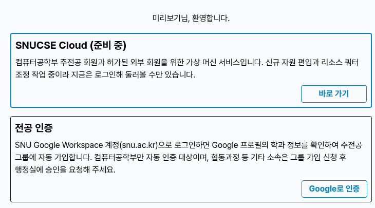
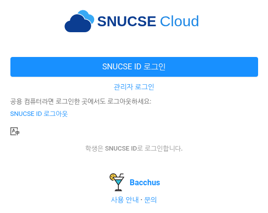

# 이용 대상과 로그인

## 이용 대상

- **컴퓨터공학부 주전공**: [SNUCSE ID](https://id.snucse.org)에서 **주전공 인증**을 마치면 "컴퓨터공학부 주전공" 그룹에 들어가고, 그 순간부터 SNUCSE Cloud에 로그인할 수 있습니다. 주전공 인증은 SNU Google Workspace(snu.ac.kr) 계정으로 학과를 확인하는 절차이며, SNUCSE ID 첫 화면에 있습니다.
- **허가된 외부 회원**: 주전공이 아니지만 사용이 필요하면 <contact@bacchus.snucse.org>로 문의해 주세요. 외부 회원을 위한 **게스트 그룹**을 SNUCSE ID에 신설할 예정이며, 그 그룹에 추가되면 같은 방법으로 로그인할 수 있습니다.

## 로그인

1. <https://cloud.snucse.org>에 접속합니다.
2. 로고 아래의 **SNUCSE ID 로그인** 버튼을 누릅니다. 그 아래 접혀 있는 **관리자 로그인**은 운영진용입니다.
3. SNUCSE ID에 로그인하고, 처음 한 번 뜨는 권한 요청을 승인합니다.

첫 로그인에서 계정이 자동으로 만들어집니다. 계정 이름은 SNUCSE ID 유저명(이메일 주소가 아닌 SNUCSE ID 아이디)과 같습니다. 학생은 따로 비밀번호 없이 SNUCSE ID로 로그인합니다.

로그인 화면에 "아직 사용할 수 없는 계정입니다"라는 안내가 나오면 아직 이용 대상 그룹에 없는 것입니다. 주전공 인증을 마친 뒤 다시 로그인해 주세요.

## 로그아웃

SNUCSE Cloud에서 로그아웃하면 SNUCSE Cloud에서만 로그아웃되고, SNUCSE ID에는 로그인된 채로 남습니다. 그 브라우저에서 누군가 다시 **SNUCSE ID 로그인**을 누르면 비밀번호 없이 내 계정으로 들어갈 수 있습니다. 실습실처럼 여럿이 쓰는 컴퓨터에서는 로그아웃한 뒤 로그인 화면의 "공용 컴퓨터라면 로그인한 곳에서도 로그아웃하세요" 아래 **SNUCSE ID 로그아웃** 링크를 눌러 SNUCSE ID에서도 로그아웃하세요.

## 그룹에서 빠지면

이용 대상 그룹에서 빠지면(예: 졸업) 다음 로그인 때 계정이 비활성화됩니다. 인스턴스는 정지된 채 보존되고, 그룹에 다시 들어오면 계정도 다시 활성화됩니다. 계정과 인스턴스가 정리되는 기준은 정식 오픈 때 안내합니다.
