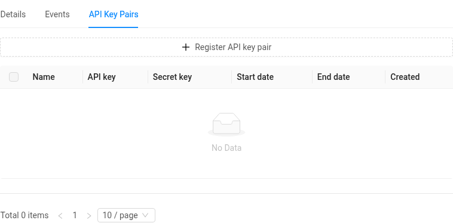
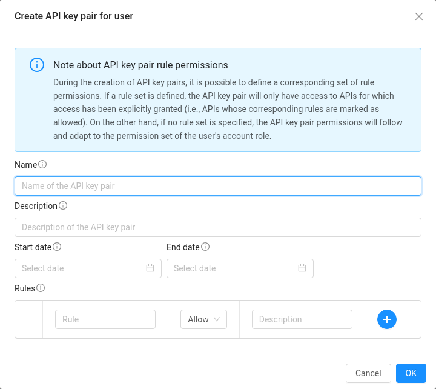

# 수업·연구실에서 쓰기 (조교·관리자 가이드)

한 사람이 인스턴스를 만들고 여러 사람이 그 안의 계정으로 접속하는 형태입니다. 수업 실습 서버, 연구실 공용 서버, 세미나용 GPU 서버가 여기에 해당합니다. 관리하는 사람(교수·조교·연구실 관리자)은 인스턴스를 만들고 지우는 **소유자**, 나머지(수강생·참여자)는 인스턴스 안의 계정으로만 들어오는 **게스트**입니다.

## 준비: 쿼터 신청

1. 인스턴스를 만들고 관리할 사람 **한 명**(조교 또는 연구실 관리자)이 본인 계정의 **쿼터 신청 → 내 신청**에서 [쿼터](quota.md#쿼터-신청)를 신청합니다. 필요한 vCPU, 메모리, 스토리지, GPU와 만료일(예: 학기 말)을 적고, 이유 칸에 수업(또는 연구실) 이름과 인원, 쓰는 기간을 적어 주세요. SNUCSE Cloud는 팀·프로젝트 단위 계정을 제공하지 않으므로 쿼터는 이 사람의 계정에 들어갑니다.
2. 쿼터가 승인되면 인스턴스를 만듭니다. 실습 서버 한 대에 학생별 계정을 만들어도 되고, 학생마다 인스턴스를 하나씩 만들어도 됩니다. 관리를 나눌 사람(다른 조교)이 있으면 그 사람에게는 sudo를 준 게스트 계정을 열어 주면 됩니다. 인스턴스를 만들고 지우는 것은 소유자만 할 수 있습니다.
3. GPU 인스턴스에는 [사용 기한](instance.md#gpu-인스턴스의-사용-기한)이 있어서, 소유자가 하루에 한 번쯤 **기한 갱신**을 눌러야 계속 켜져 있습니다. 게스트는 갱신할 수 없습니다.

## 학생 등록

1. 학생들에게 **cloud.snucse.org에 한 번 로그인**하라고 안내하고 SNUCSE ID 유저명을 모읍니다. 로그인 전에는 계정이 없어서 아래 태그가 효력이 없습니다. SNUCSE ID가 없는 외부 참여자는 [이용 대상](account.md)을 참고하세요.
2. 인스턴스 안에서 계정을 만듭니다. 사람마다 하나씩(`sudo adduser hong`) 또는 공용 계정 하나(`sudo adduser student`). sudo를 줄지, 홈 디스크를 어떻게 나눌지는 관리자가 정합니다.
3. 웹 UI의 **컴퓨트 → 인스턴스**에서 인스턴스를 열고, 왼쪽 정보 카드를 맨 아래로 내리면 **태그**가 있습니다. **새 태그**를 누르면 키와 값 칸이 나옵니다. 키는 `ssh.account.<계정 이름>`, 값은 그 계정으로 들어올 SNUCSE ID 유저명을 쉼표로(공백 없이) 나열하고 체크 표시를 누릅니다.

   | 키 | 값 | 뜻 |
   | --- | --- | --- |
   | `ssh.account.yun` | `yun` | yun은 자기 계정으로 |
   | `ssh.account.student` | `hong,kim,lee` | 세 명이 공용 계정 `student`로 |

   값 한 칸에는 8192자까지 들어가므로 한 계정에 SNUCSE ID 수백 개를 적을 수 있습니다. 같은 키를 두 번 만들 수는 없습니다. 이름이 수십 명을 넘으면 아래 [CLI로 한 번에 등록하기](#cli로-한-번에-등록하기)를 쓰세요.
4. 학생에게 접속 문자열을 알려 줍니다. 처음 접속 때 브라우저 로그인이 한 번 필요합니다([접속하기](access.md)).

   ```console
   $ ssh -p 2222 <SNUCSE ID 유저명>:<인스턴스 이름>:<계정 이름>@cloud.snucse.org
   ```

태그를 넣고 1분 안에 접속이 됩니다. 학생은 인스턴스를 정지·삭제하거나 콘솔을 열 수 없고, 태그에 적힌 계정으로 SSH만 됩니다.

## CLI로 한 번에 등록하기

수강생이 수백 명이면 태그를 손으로 넣기 어렵습니다. CloudStack API를 쓰는 공식 CLI [cloudmonkey](https://github.com/apache/cloudstack-cloudmonkey/releases)(`cmk`)로 한 번에 넣을 수 있습니다.

### API 키 만들기

오른쪽 위의 본인 이름 → **정보** → **API 키 쌍** 탭 → **API 키 쌍 등록**. 이름만 적고 **확인**을 누르면 표에 API 키와 비밀 키가 나타납니다. 둘 다 비밀번호처럼 다루세요. 이 키로는 본인 계정의 자원을 API로 다룰 수 있습니다.





### cmk 설정

```console
$ cmk set profile snucse
$ cmk set url https://cloud.snucse.org/client/api
$ cmk set apikey <API key>
$ cmk set secretkey <Secret key>
$ cmk sync
```

cmk는 API를 POST로 보냅니다. cmk 대신 직접 만든 스크립트로 인스턴스를 만들거나 고칠 때(`deployVirtualMachine`, `updateVirtualMachine`)도 POST로 보내세요. 모든 템플릿에 붙는 초기 설정 스크립트(user data)가 GET 요청의 한도(4 KB)를 넘어 GET으로는 `User data is too long for http GET request` 오류가 납니다. 만든 뒤 user data를 바꿀 때는 `updateVirtualMachine`의 `userdata` 값으로 보냅니다(인스턴스 편집 창의 user data 칸도 같은 명령을 씁니다).

바꾼 user data가 언제 적용되는지는 [사용자 데이터](instance.md#사용자-데이터)를 보세요.

인스턴스 ID를 찾습니다.

```console
$ cmk list virtualmachines filter=id,name
```

### 태그 넣기와 빼기

키에 대괄호가 들어가므로 따옴표로 감쌉니다.

```console
$ cmk create tags resourceids=<인스턴스 ID> resourcetype=UserVm \
    'tags[0].key=ssh.account.student' 'tags[0].value=kim,lee,park'
$ cmk delete tags resourceids=<인스턴스 ID> resourcetype=UserVm \
    'tags[0].key=ssh.account.student'
```

SNUCSE ID를 한 줄에 하나씩 적은 파일(`ids.txt`)이 있으면, 아래 스크립트(bash)가 쉼표로 이어 태그 하나로 넣습니다.

```bash
#!/bin/bash
VM=<인스턴스 ID>; ACCOUNT=student
ids=$(grep -v '^$' ids.txt | paste -sd, -)
cmk create tags resourceids=$VM resourcetype=UserVm "tags[0].key=ssh.account.$ACCOUNT" "tags[0].value=$ids"
```

이미 같은 키가 있으면 오류가 나므로, 명단을 바꿀 때는 먼저 `cmk delete tags`로 지우고 다시 넣습니다. 태그가 반영되면 1분 안에 접속이 열립니다.

## 학기가 끝나면

- 태그를 지우면 1분 안에 접속이 끊기고 막힙니다. 인스턴스 안 계정과 파일은 남습니다.
- 인스턴스를 지우면 vCPU·메모리·GPU 쿼터가 돌아옵니다. 데이터 디스크와 남긴 루트 디스크는 볼륨으로 남아 스토리지 쿼터를 차지하니, 필요 없는 볼륨은 지워야 쿼터가 돌아옵니다([인스턴스 삭제와 루트 디스크](instance.md#인스턴스-삭제와-루트-디스크)). 필요한 데이터는 미리 받아 두세요.
- 다음 학기에도 쓰려면 만료일 전에 그 승인의 **갱신 신청**을 하세요([만료와 갱신](quota.md#만료와-갱신)).
