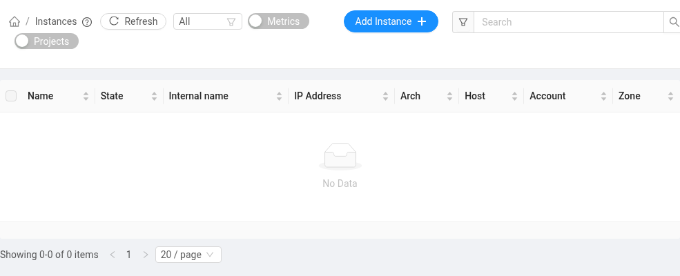

# 인스턴스 만들기와 관리

왼쪽 메뉴의 **컴퓨트 → 인스턴스**에서 **인스턴스 추가**를 누릅니다.

순서대로 템플릿(운영체제), 컴퓨트 오퍼링(CPU·메모리·GPU), 운영체제 디스크, 데이터 디스크(선택), 이름을 정하면 됩니다. 네트워크는 하나뿐이라 자동으로 선택됩니다. 템플릿 대신 내 볼륨이나 스냅샷으로 만들 수도 있습니다([내 디스크로 인스턴스 만들기](volume.md#내-디스크로-인스턴스-만들기)). 입력을 마치면 **배치** 항목이 그 조합이 지금 들어갈 자리가 있는지 알려 줍니다([배치 확인과 디스크 이동](#배치-확인과-디스크-이동)).

**운영체제 디스크**는 기본 20 GB(운영진이 정한 값)이고, 같은 이름의 단계에서 크기를 바꿀 수 있습니다. 최소 크기는 템플릿 크기와 운영진이 정한 하한(지금은 10 GB) 중 큰 값이고, 최대 크기는 남은 스토리지 쿼터입니다. 데이터 디스크는 그다음 단계에서 크기를 입력합니다. 디스크는 나중에 늘릴 수 있지만 줄일 수는 없습니다([디스크 늘리기](#디스크-늘리기)). CPU 인스턴스의 vCPU는 2개 단위(운영진이 바꿀 수 있습니다)로, 최대치는 남은 CPU·메모리 쿼터입니다.

템플릿은 운영진이 등록한 것만 쓸 수 있고 직접 올릴 수는 없습니다. 필요한 운영체제나 이미지가 있으면 <contact@bacchus.snucse.org>로 요청해 주세요.

- 이름은 직접 정하고, 비워 두면 `VM-0`, `VM-1`, … 순서로 붙습니다. 규칙은 [인스턴스 이름](#인스턴스-이름)에 있습니다. SSH로 접속할 때는 이 이름에 계정 접두어가 붙은 SSH 이름을 씁니다.
- 만들기가 끝나면 **인스턴스 접속 정보** 창에 SSH 명령, 로그인 계정, 인스턴스 비밀번호가 나옵니다. 인스턴스 비밀번호는 웹 콘솔 로그인에만 쓰고 이 창에서만 볼 수 있으니, 필요하면 복사해 두세요([웹 콘솔](access.md#웹-콘솔)). SSH 명령과 로그인 계정은 인스턴스 화면에도 계속 나옵니다.
- 만들어진 인스턴스는 목록이나 인스턴스 화면에서 **인스턴스 정지**, **인스턴스 시작**, **인스턴스 재시작**, **인스턴스 파기**(삭제, 되돌릴 수 없음)를 할 수 있습니다. 컴퓨트 오퍼링은 정지 상태에서만 **인스턴스 확장**으로 바꿀 수 있습니다.
- 정지된 인스턴스와 남긴 볼륨, 스냅샷도 스토리지 쿼터를 그대로 차지합니다. 쓰지 않으면 삭제해 주세요([볼륨과 스냅샷](volume.md)).

## 인스턴스 이름

화면에 보이는 이름은 만들기 마지막 단계의 **이름(옵션)** 칸에 직접 적습니다.

- 영문 대소문자·숫자·하이픈(`-`)으로 30자까지 쓸 수 있고, 하이픈으로 시작하거나 끝날 수 없습니다.
- 내 계정 안에서만 겹치지 않으면 됩니다. 대소문자는 구분하지 않아서 `Test`와 `test`는 같은 이름입니다. 다른 사람이 같은 이름을 써도 상관없습니다.
- 비워 두면 `VM-0`, `VM-1`, … 가운데 비어 있는 가장 작은 번호가 이름이 됩니다.

### SSH 이름

SSH로 접속할 때는 이름 앞에 계정 접두어가 붙은 **SSH 이름**을 씁니다. 접두어는 SNUCSE ID 계정이면 `snucse-<SNUCSE ID 유저명>-`, Bacchus 계정이면 `bacchus-<아이디>-`입니다. 접두어는 자동으로 붙으므로 직접 입력하지 않으며, 덕분에 다른 사람의 인스턴스와 이름이 겹치지 않습니다.

예를 들어 유저명이 `baneling100`인 학생이 `test`라는 이름으로 만들면 SSH 이름은 `snucse-baneling100-test`이고, 접속 명령은 `ssh -p 2222 baneling100:snucse-baneling100-test@cloud.snucse.org`입니다. SSH 이름에서는 대문자가 소문자로 바뀝니다. 아이디가 `x`로 시작하거나 `.`, `_`, `-`를 포함하면 접두어의 일부 글자가 달라지므로, 명령을 직접 조립하지 말고 인스턴스 화면의 **SSH 접속**에서 복사해 쓰세요([SSH](access.md#ssh)).

인스턴스 안의 호스트 이름(`hostname`)도 만들 때 SSH 이름으로 정해지고(같은 호스트 이름이 이미 있으면 뒤에 번호가 붙습니다), 그 뒤로는 바뀌지 않습니다.

### 이름 바꾸기

인스턴스 화면의 **인스턴스 편집**에서 **이름 표시** 칸을 고칩니다. 위의 규칙이 그대로 적용됩니다.

- SSH 명령도 새 이름으로 바뀝니다. 1분쯤 지나면 새 이름으로 접속되고, 이전 이름으로는 접속되지 않습니다. 게스트가 있다면 새 명령을 알려 주세요([게스트](access.md#다른-사람에게-접속-권한-주기-게스트)).
- 인스턴스 안의 호스트 이름은 그대로입니다. 바꾸려면 인스턴스 안에서 `sudo hostnamectl set-hostname <새 이름>`을 실행하세요.
- 이름이 `<이름>-ROOT`인 운영체제 디스크 볼륨은 새 이름에 맞춰 같이 바뀝니다.

### 예전에 만든 인스턴스

이 이름 규칙이 생기기 전에 만든 인스턴스는 옛 이름과 옛 SSH 명령을 그대로 씁니다. 이름 표시를 바꿔도 이들의 SSH 이름은 바뀌지 않으니, 인스턴스 화면에 나오는 명령을 쓰세요. 운영체제 디스크 볼륨의 이름도 `ROOT-<번호>` 그대로입니다.

## 컴퓨트 오퍼링

| 종류 | 오퍼링 | 고르는 것 |
| --- | --- | --- |
| CPU 인스턴스 | `cpu` 하나 | vCPU 수와 메모리를 직접 입력 |
| GPU 인스턴스 | GPU 종류와 장수마다 하나(예: `a6000-1`) | 오퍼링만 고르면 vCPU와 메모리가 GPU 수에 맞춰 정해짐 |

- **CPU 인스턴스**: vCPU는 2개 단위(2, 4, 6, …)로 정합니다. vCPU 2개가 물리 코어 1개(그 코어의 하드웨어 스레드 2개)이고, 인스턴스가 실행되는 동안 그 코어는 그 인스턴스만 씁니다. 다른 인스턴스와 코어를 나눠 쓰지 않습니다. 메모리는 GiB 단위로, 0.1 GiB씩 정합니다.
- vCPU·메모리·디스크 입력의 최대치는 남은 쿼터뿐입니다. 호스트(인스턴스가 실행되는 물리 서버)에 남은 자리는 입력을 막지 않고, 아래 배치 확인에서 따로 알려 줍니다.
- CPU 인스턴스는 가능한 한 적은 수의 호스트에 모아서 놓습니다. 작은 인스턴스가 여러 호스트에 흩어지지 않아야 큰 인스턴스가 들어갈 큰 빈자리가 남기 때문입니다.
- **GPU 인스턴스**는 [GPU](gpu.md)를 보세요. GPU 인스턴스에는 [사용 기한](#gpu-인스턴스의-사용-기한)이 있습니다.

## 배치 확인과 디스크 이동

만들기 단계의 **배치** 항목은 지금 고른 조합이 들어갈 자리가 있는지 알려 줍니다. 한 호스트에 남은 vCPU·메모리·디스크의 최대치(각각 따로 센 값)와 함께, 고른 조합에 대한 판정을 보여 줍니다.

- 지금 있는 그대로 시작할 수 있음
- 디스크를 옮긴 뒤에야 시작할 수 있음(옮길 크기와 예상 시간)
- 지금은 할 수 없음(이유: 쿼터, 여유 CPU 코어, 메모리, GPU, 로컬 디스크 공간 등)

이 수치는 참고용입니다. 인스턴스를 만들거나 시작할 때 SNUCSE Cloud가 다시 판단하므로 그 사이에 값이 바뀔 수 있습니다. 그 사이에 다른 사람이 먼저 자리를 차지하면, 보고 있던 판정과 달리 실패하거나 다시 묻습니다. 만들기 단계에서 "지금은 할 수 없습니다"라고 나온 조합도 제출할 수는 있지만 같은 이유로 실패합니다.

정지된 인스턴스를 시작하거나, 실행 중인 인스턴스에 다른 호스트의 볼륨을 붙이거나, 남긴 볼륨으로 인스턴스를 만들 때 디스크를 다른 호스트로 옮겨야 하면 확인 창("디스크를 먼저 옮겨야 합니다")이 뜹니다. 창에는 옮길 디스크와 크기(전체 크기와 실제 사용량), 예상 시간이 나오고, 옮기는 동안 그 디스크를 쓸 수 없다는 것과 이전 복사본이 어떻게 되는지도 적혀 있습니다.

- **이동 승인**을 눌러야만 옮깁니다. **취소**하면 아무것도 옮기지 않고 인스턴스도 시작하지 않습니다. 승인 없이 디스크가 옮겨지는 일은 없습니다.
- 옮기는 동안 인스턴스는 "마이그레이션중"으로 보이고, 다 옮기면 이어서 시작합니다. 디스크가 크면 몇 시간 걸릴 수 있습니다.
- 이동은 복사입니다. 이전 호스트의 디스크는 `<볼륨 이름>-previous-<날짜>`(예: `test-ROOT-previous-20261021`) 볼륨으로 남고, 직접 지울 때까지 스토리지 쿼터를 차지합니다. 새 위치에서 잘 쓰는 것을 확인한 뒤 볼륨 목록에서 **볼륨 파기**로 지우세요([볼륨 지우기](volume.md#볼륨-지우기)). 운영진이 이 동작을 끈 경우에는 이동이 끝난 뒤 이전 복사본이 삭제되며, 확인 창이 어느 쪽인지 알려 줍니다.
- 이전 복사본을 남기려면 옮길 디스크 크기만큼 스토리지 쿼터가 남아 있어야 합니다. 모자라면 "남은 스토리지 쿼터가 부족합니다"로 거부됩니다.
- 확인 창을 띄운 뒤 상황이 바뀌었거나 창을 오래(15분 넘게, 운영진이 정한 값) 열어 두었으면 새 판정으로 다시 묻습니다. 승인은 창에 보인 그 이동에만 쓰입니다.
- 옮기다가 실패하면(예: 호스트 점검이 시작됨) 아무것도 바뀌지 않습니다. 인스턴스는 정지된 채로, 디스크는 원래 호스트에 그대로 남고, 이전 복사본도 생기지 않습니다. 나중에 다시 시작하세요.
- 다 옮긴 뒤 시작만 실패하면 디스크는 새 호스트에 남아 있고(이동은 끝난 것으로 남음), 오류 문구가 그렇다고 알려 줍니다.
- 정지된 인스턴스에 볼륨을 붙일 때는 붙였다는 것만 기록합니다. 옮겨야 하는지는 그 인스턴스를 시작할 때 묻습니다.

## 인스턴스 상태

| 상태 | 붙잡고 있는 것 | 이렇게 됩니다 |
| --- | --- | --- |
| 실행 중 | CPU 코어, 메모리, GPU, 디스크 | 만들기, 시작 |
| 정지 | 디스크만 | **인스턴스 정지**, 인스턴스 안에서 끄기(`sudo poweroff`), 호스트 점검, GPU 사용 기한 만료 |
| 삭제 | 없음(루트 디스크는 기본으로 볼륨으로 남음) | **인스턴스 파기**(바로 삭제, 되돌릴 수 없음) |

- 정지하면 CPU 코어·메모리·GPU를 바로 반납하고, 다른 사람이 쓸 수 있게 됩니다. 다시 시작할 때 자리를 새로 잡으므로, 원래 호스트가 차 있으면 디스크를 옮겨야 할 수 있습니다([배치 확인과 디스크 이동](#배치-확인과-디스크-이동)).
- **인스턴스 재시작**(재부팅)은 아무것도 반납하지 않습니다. 같은 호스트, 같은 코어와 GPU로 다시 켜집니다.
- 정지된 인스턴스도 리소스 쿼터(vCPU·메모리·GPU·스토리지)는 그대로 차지합니다. 쿼터는 가진 인스턴스의 크기로 세고, 서버 자원은 실행 중인 인스턴스만 씁니다.

## 인스턴스 삭제와 루트 디스크

휴지통은 없습니다. **인스턴스 파기**를 하면 인스턴스가 바로 지워지고 되돌릴 수 없습니다.

**인스턴스 파기**를 누르면 확인 창이 열립니다.

- 창에 "삭제하려면 리소스 이름을 정확히 입력하십시오"라는 안내와 인스턴스 이름이 나옵니다. 그 이름을 그대로 입력해야 **확인**을 누를 수 있습니다(대소문자를 구분하고, 앞뒤 공백은 무시합니다). 목록에서 인스턴스 여러 개를 골라 한꺼번에 지울 때는 이름 대신 고른 개수를 입력합니다.
- **루트 디스크 남기기**는 기본으로 켜져 있습니다.
  - 켠 채로 삭제하면 루트 디스크는 같은 이름(`<인스턴스 이름>-ROOT`, 예전에 만든 인스턴스는 `ROOT-<번호>`)의 볼륨으로 **스토리지 → 볼륨**에 남습니다. 남긴 볼륨은 스토리지 쿼터를 차지합니다.
  - 끄고 삭제하면 루트 디스크도 인스턴스와 함께 바로 지워집니다.
- 데이터 디스크는 인스턴스를 삭제해도 지워지지 않고 볼륨으로 남습니다. 삭제 창의 **삭제될 데이터 볼륨**에서 고르면 함께 지울 수 있고, 아니면 나중에 따로 지우세요.
- 오류(Error) 상태인 인스턴스는 남길 루트 디스크가 없는 것으로 보고 루트 디스크 없이 삭제됩니다.
- 운영체제 디스크의 스냅샷이 만들어지는 중에는 인스턴스를 삭제할 수 없습니다. 스냅샷의 상태가 **백업됨**이 된 뒤에 삭제하세요.

남긴 루트 디스크로 다시 인스턴스를 만들려면 볼륨 목록에서 그 볼륨을 고르고 **이 볼륨으로 인스턴스 만들기**를 누릅니다. 만들기 화면이 그 볼륨을 고른 채로 열리고, 컴퓨트 오퍼링만 고르면 됩니다. 그 볼륨이 있는 호스트에 자리가 없으면 디스크를 옮겨도 되는지 묻습니다([내 디스크로 인스턴스 만들기](volume.md#내-디스크로-인스턴스-만들기)). 다른 인스턴스에 붙여 데이터만 꺼낼 수도 있습니다([데이터 꺼내기](rescue.md)).

필요 없어진 루트 디스크와 데이터 디스크는 볼륨 목록에서 **볼륨 파기**로 지웁니다([볼륨 지우기](volume.md#볼륨-지우기)). 지운 볼륨은 복구되지 않으니 필요한 데이터는 미리 옮겨 두세요. 스냅샷을 만들어 두었다면 볼륨을 지운 뒤에도 거기서 되살릴 수 있습니다([볼륨과 스냅샷](volume.md)).

## 디스크 늘리기

볼륨 목록에서 디스크를 고르고 **볼륨 크기 변경**으로 늘립니다. 줄일 수는 없습니다.

- **운영체제 디스크**(이름이 `<인스턴스 이름>-ROOT`인 볼륨, 예전에 만든 인스턴스는 `ROOT-<번호>`): 늘린 뒤 인스턴스를 재시작하면, 부팅 때 cloud-init이 파티션과 파일시스템을 새 크기에 맞게 늘립니다(`growpart`, `resizefs`).
- **데이터 디스크**: 파일시스템은 직접 늘립니다. 예: 파티션이 있으면 `sudo growpart /dev/vdb 1` 뒤에 ext4는 `sudo resize2fs /dev/vdb1`, XFS는 `sudo xfs_growfs <마운트 위치>`.

## GPU 인스턴스의 사용 기한

GPU는 쓰지 않는 동안 붙잡고 있으면 다른 사람이 쓸 수 없으므로, GPU 인스턴스에는 사용 기한이 있습니다. CPU 인스턴스에는 기한이 없습니다.

- GPU 인스턴스는 **시작한 때 또는 마지막으로 기한을 갱신한 때부터 36시간**(운영진이 정한 값) 뒤에 자동으로 정지됩니다.
- 남은 시간은 인스턴스 정보의 **남은 기한**과 대시보드의 **GPU 사용 기한** 카드에 나옵니다.
- 더 쓰려면 하루에 한 번쯤 **기한 갱신**을 누르세요(인스턴스 화면 또는 대시보드). 갱신하면 기한이 그때부터 다시 36시간이 됩니다. 남은 시간에 더해지는 것이 아니라 새로 정해지므로, 매일 비슷한 시각에 갱신하면 12시간쯤 여유가 남습니다. 실행 중인 인스턴스만 갱신할 수 있습니다.
- 기한 4시간 전과 1시간 전(운영진이 정한 값)에 알림이 이벤트와 화면에 나옵니다. 메일 알림은 준비되는 대로 함께 보냅니다.
- 기한이 끝나면 인스턴스가 정지됩니다. 디스크는 그대로 남고, GPU·CPU·메모리만 반납됩니다. 다시 시작하면 그때부터 새 36시간이 주어집니다(빈 GPU가 있어야 시작됩니다).
- 재시작(재부팅)과 재설치는 기한을 바꾸지 않습니다. 정지했다가 시작하면 새 기한이 시작됩니다.
- **쿼터가 만료되면 연장·재시작이 막히고, 현재 기한이 끝나면 정지됩니다.** GPU 쿼터가 만료되었거나 모자라면 기한 갱신이 거부되고, 인스턴스는 지금의 기한이 끝날 때 정지되며, 쿼터가 다시 생길 때까지 시작할 수 없습니다([리소스 쿼터](quota.md)).
- 오래 걸리는 작업은 중간 결과를 디스크에 저장해 두세요. 연구 일정 때문에 한 번 더 긴 기한이 꼭 필요하면 <contact@bacchus.snucse.org>로 문의해 주세요. 운영진이 그 실행 동안의 기한을 따로 정해 줄 수 있고, 다음에 시작할 때는 다시 36시간입니다.

## 호스트 점검

운영진이 호스트를 점검할 때는 로그인한 뒤 보이는 웹 UI의 화면 위쪽 공지로 미리 알립니다.

- 점검이 시작되면 그 호스트에서 실행 중인 인스턴스는 정지됩니다. 실행 중에 다른 호스트로 옮겨 주지 않으므로, 공지를 보면 점검 전에 저장하지 않은 작업을 정리하세요.
- 점검하는 동안에는 그 호스트에 디스크가 있는 인스턴스를 시작할 수 없습니다. 배치 확인에 "볼륨이 있는 호스트를 지금은 쓸 수 없습니다"가 나오면 점검이 끝난 뒤 다시 시작하세요. 그 호스트에서 진행 중이던 디스크 이동은 멈추고, 인스턴스와 디스크는 이동 전 상태로 돌아갑니다.
- 점검이 끝난 뒤 시작하면 평소처럼 자리를 다시 잡습니다. 원래 호스트에 자리가 있으면 그대로 시작하고, 없으면 디스크를 옮겨도 되는지 묻습니다.
- 호스트의 디스크(스토리지)만 점검할 때는 그 디스크를 쓰는 인스턴스가 정지되었다가 점검이 끝나면 다시 시작됩니다. 다만 쿼터를 넘은 계정의 인스턴스는 다시 시작되지 않고 정지된 채 남습니다.

## CPU가 다른 호스트로 옮겨진 뒤

인스턴스는 호스트의 CPU를 그대로 봅니다. 호스트마다 CPU 종류가 다를 수 있어서, 디스크를 다른 호스트로 옮겨 시작하면 인스턴스 안에서 보이는 CPU가 바뀔 수 있습니다. 빌드한 기계의 CPU에 맞춰 컴파일한 프로그램(`-march=native` 등)은 옮긴 뒤 `Illegal instruction`으로 실패할 수 있으니, 다시 빌드하거나 특정 CPU에 묶이지 않는 옵션으로 빌드하세요.

## 사용자 데이터

인스턴스를 만들 때나 **인스턴스 편집**의 **사용자 데이터** 칸에 넣는 user data(cloud-config나 셸 스크립트)는 cloud-init이 처리하는 추가 설정입니다. 모든 템플릿에는 운영진의 기본 스크립트(접속 게이트웨이 키 등)가 붙어 있어 언제나 실행되고, 내 user data는 그 뒤에 덧붙습니다.

user data를 바꿔도 이미 돌고 있는 운영체제에 다시 적용되지는 않습니다. cloud-init은 user data를 인스턴스마다 한 번, 첫 부팅 때 실행하기 때문입니다. 바꾼 내용은 인스턴스를 재설치(**인스턴스 재설치**)하면 적용되고(새 운영체제 디스크가 처음부터 cloud-init을 돕니다), 매 부팅마다 도는 부분(`bootcmd`, per-boot 스크립트)은 다음 부팅부터 바뀐 내용을 씁니다. 같은 디스크에서 모두 다시 돌리려면 인스턴스 안에서 `sudo cloud-init clean --reboot`을 실행하세요. 첫 부팅 단계를 다시 하므로 SSH 호스트 키 같은 것이 새로 만들어질 수 있고, 그러면 접속 게이트웨이가 바뀐 키를 받아들이지 않을 수 있습니다(재설치 때와 달리 자동으로 받아들이지 않습니다). 그때는 <contact@bacchus.snucse.org>로 알려 주세요.

## 템플릿

각 배포판의 공식 클라우드 이미지를 그대로 씁니다. 템플릿은 학기마다 새 이미지로 갱신하고, 인스턴스 안의 패키지는 배포판의 패키지 관리자(`apt`, `dnf`, `zypper`, `pacman`, `apk`)로 직접 업데이트하세요. SSH와 웹 콘솔은 아래 기본 사용자(인스턴스 화면의 **로그인 계정**)로 들어가며, 이 사용자는 비밀번호 없이 관리자 권한을 쓸 수 있습니다(Alpine은 `doas`, 나머지는 `sudo`). root로는 직접 로그인하지 않습니다.

| 템플릿 | 기본 사용자 | 비고 |
| --- | --- | --- |
| Ubuntu 26.04 LTS | `ubuntu` | 기본 선택 |
| Ubuntu 24.04 LTS | `ubuntu` | 첫 부팅 후 접속까지 2~3분 |
| Debian 13 | `debian` | 첫 부팅 후 접속까지 2~3분 |
| Debian 12 | `debian` | 첫 부팅 후 접속까지 2~3분 |
| Fedora 44 | `fedora` | |
| Rocky Linux 9 | `rocky` | |
| AlmaLinux 10 | `almalinux` | |
| AlmaLinux 9 | `almalinux` | |
| openSUSE Leap 15.6 | `opensuse` | |
| Arch Linux | `arch` | 첫 부팅 후 접속까지 2~3분 |
| Alpine Linux 3.22 | `alpine` | 관리자 권한은 `doas` |
| Alpine Linux 3.21 | `alpine` | 관리자 권한은 `doas` |

"첫 부팅 후 접속까지 2~3분"인 템플릿은 인스턴스를 처음 만들거나 재설치한 뒤 네트워크 설정이 끝날 때까지 SSH 접속과 콘솔 로그인이 되지 않습니다. 기다리면 접속됩니다. 두 번째 부팅부터는 바로 접속됩니다.
